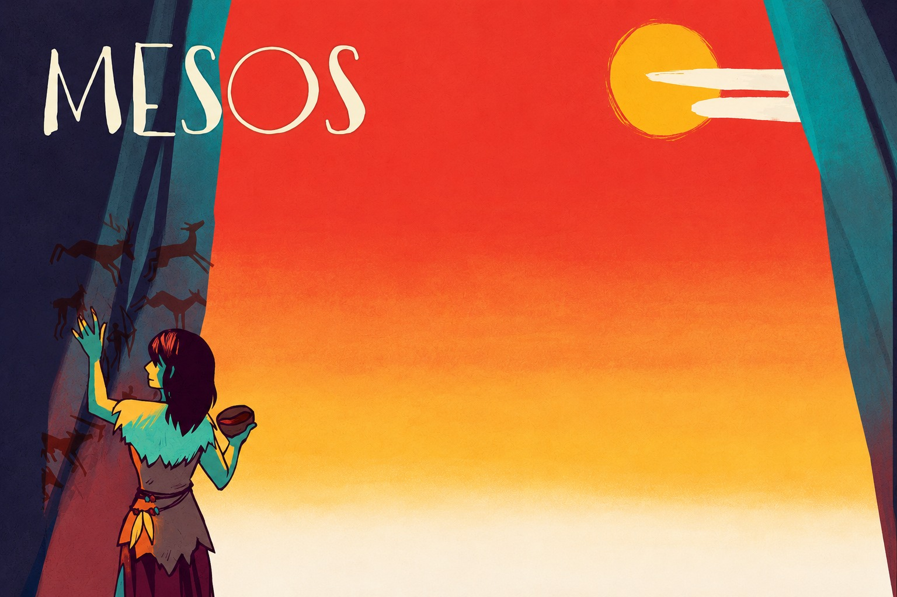

<p align="center">
  
</p>

<p align="center">
  <b>Software Engineering Project</b> · Politecnico di Milano · A.Y. 2025/2026 · <b>Final grade: 30 cum laude</b>
</p>

---

## About

This is a digital version of **Mesos**, the card game by *Yaniv Kahana* and *Simone Luciani* published by **Cranio Creations**.

We followed the **official board game** closely. The rules, the cards, the tiles and the scoring are the ones in the published edition. All 117 cards (characters, events and buildings) have their original values and effects, and the server checks every move, so the game can only be played by the rules.

- **2 to 5 players** over the network
- **Graphical interface** with the original card and board artwork
- **Text interface** for playing from a terminal
- Players using different interfaces can play in the same match
- If your connection drops, you can rejoin the match
- An interrupted match is saved and resumes where it stopped

## Gameplay

<!-- Gameplay video: on GitHub, edit this README in the browser and drag an .mp4 file here. GitHub then inserts a link that plays inside the page. -->

## Rules

The game follows the official rulebook:

📖 **[Read the official Mesos rulebook (PDF, Italian)](docs/Mesos-Rulebook-ITA.pdf)**

---

## How to run

Requires **Java 23** or later.

**Start the server:**

```bash
java -jar deliverables/final/jar/mesos-server.jar
```

**Connect each player** (use the server's IP address instead of `localhost` when playing across computers):

```bash
java -jar deliverables/final/jar/mesos-client.jar socket localhost 1234
```

or over RMI:

```bash
java -jar deliverables/final/jar/mesos-client.jar rmi localhost 1099 MesosServer
```

After connecting, type `1` for the text interface or `2` for the graphical one.

**Start a new match** without resuming the saved one:

```bash
java -jar deliverables/final/jar/mesos-server.jar --fresh
```

**Rebuild the JAR files** (requires Maven 3.9 or later):

```bash
mvn clean package
```

> The original game artwork is copyrighted and is not included in this repository. To see the graphics, place it in `src/main/resources/assets/`.

---

<p align="center">
  <sub><i>Mesos</i> is a game by Yaniv Kahana and Simone Luciani, published by Cranio Creations. This project was made for educational purposes only.</sub>
</p>
